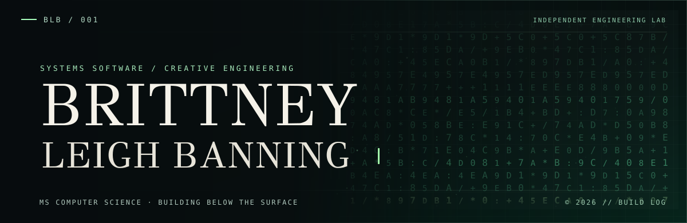

**I build where low-level systems meet thoughtful human interfaces.**

[**BIT FOUNDRY LABS**](https://github.com/bit-foundry-labs) &nbsp; / &nbsp; [**SELECTED BUILDS**](#selected-builds) &nbsp; / &nbsp; [**FIELD NOTES**](#field-notes)

 

### 00 / THE WORK

I'm a computer science master's student drawn to the machinery most people never see: kernels, concurrency, distributed systems, programming languages, and the protocols holding everything together.

I'm equally interested in what people *do* see. Software can be technically rigorous and still feel surprising, intuitive, and beautiful. My work moves between those two layers.

These days, I'm exploring how to build an operating system from the ground up, developing bounded developer agents at [Bit Foundry Labs](https://github.com/bit-foundry-labs), and experimenting with more expressive interfaces.

> The questions I keep coming back to: **How does it work beneath the surface? What happens when we redesign it from first principles?**

### 01 / SELECTED BUILDS

| Project | Inside the machine |
| :--- | :--- |
| [**ForgeLoop ↗**](https://github.com/bit-foundry-labs/forge-loop) | Experimental, local-first developer automation. Persistent objectives, bounded execution, isolated worktrees, and human review gates. |
| [**Raft KV Store ↗**](https://github.com/brittneyleighb/raft-project) | A simplified Java distributed key-value store with leader election, heartbeats, log replication, and quorum-based commits. |
| [**Neural Trace ↗**](https://github.com/brittneyleighb/neural-trace) | Bash-based Linux system reconnaissance that turns process, network, and port signals into understandable security insights. |
| [**Café Nebula ↗**](https://github.com/brittneyleighb/cafe-nebula) | An early-stage Java game-engine experiment using LWJGL and OpenGL. |
| [**Ándale ↗**](https://github.com/bit-foundry-labs/andale-spanish-app) | A Mexican-Spanish language learning experiment built around contextual cloze practice and editorial interface design. |

### 02 / RESEARCH INTERESTS

`KERNEL ARCHITECTURE` &nbsp; `OPERATING SYSTEMS` &nbsp; `DISTRIBUTED CONSENSUS` &nbsp; `COMPILERS & LANGUAGES` &nbsp; `HUMAN-COMPUTER INTERACTION`

My north star: build systems that are understandable enough to study, trustworthy enough to use, and distinctive enough to remember.

### 03 / FIELD NOTES

I publish rough edges and learning materials too, not just finished work.

- [**Design of Operating Systems**](https://github.com/brittneyleighb/notes-on-operating-systems) / course notes on OS internals.
- [**Database Design Master Reference**](https://github.com/brittneyleighb/database-design-master-reference) / a learning reference on database architecture.
- [**Programming Languages Comparison**](https://github.com/brittneyleighb/programming-languages-comparison) / comparing languages through their design decisions.
- [**Git & GitHub Cheatsheet**](https://github.com/brittneyleighb/git-github-cheatsheet) / practical command reference.

### 04 / ELSEWHERE

Building under [**Bit Foundry Labs**](https://github.com/bit-foundry-labs). Open to conversations about backend engineering, developer tools, and systems research.

**Contact:** [Email](mailto:brittneyleighb@gmail.com) · [GitHub](https://github.com/brittneyleighb)

Original animated artwork lives in [assets/matrix-rain.svg](assets/matrix-rain.svg). It uses self-contained SVG/CSS; no scripts, web services, or external image dependencies. Motion is disabled when reduced motion is preferred.
