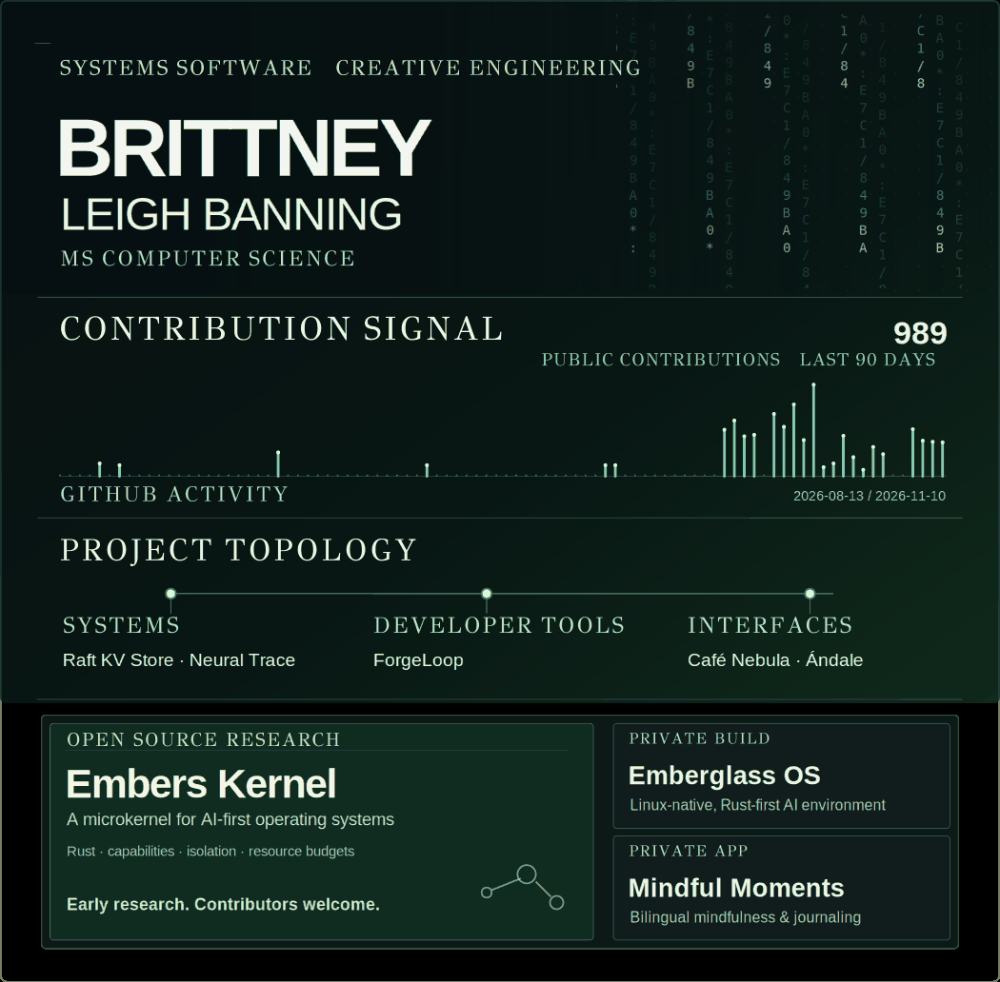

**Computer science MS student. Into operating systems, distributed systems, developer tools, and making software look good.**

[Bit Foundry Labs](https://github.com/bit-foundry-labs) · [Projects](#projects) · [Notes](#notes)

## Open source · Embers Kernel

**[Embers Kernel](https://github.com/bit-foundry-labs/embers-kernel)** is an original, Rust-first microkernel research project exploring a kernel designed for AI-first operating systems. The goal is efficient, predictable CPU, memory, and accelerator management, with capability-based isolation and explicit control over what AI agents can do.

**Early-stage research, not a finished or benchmark-proven AI-optimized kernel.** I'd love to build it with other developers.

[Contribute](https://github.com/bit-foundry-labs/embers-kernel/blob/main/CONTRIBUTING.md) · [Research roadmap](https://github.com/bit-foundry-labs/embers-kernel/blob/main/docs/CONTRIBUTOR_ROADMAP.md) · [Open issues](https://github.com/bit-foundry-labs/embers-kernel/issues)

## Building now

**Emberglass OS** (private) · A Linux-native, Rust-based environment exploring AI-first computing and activity-centered UX.

**Mindful Moments** (private) · A bilingual Flutter mindfulness and journaling app.

## Other projects

**Systems:** [Raft KV Store](https://github.com/brittneyleighb/raft-project) · [Neural Trace](https://github.com/brittneyleighb/neural-trace)

**Developer tools:** [ForgeLoop](https://github.com/bit-foundry-labs/forge-loop) (private)

**Apps + games:** [Café Nebula](https://github.com/brittneyleighb/cafe-nebula) · Ándale (private)

## Currently

Building apps, games, developer tools, and systems software. I care about innovation, creativity, beautiful design, and software that feels clean and efficient under the hood.

## Notes

[Operating systems](https://github.com/brittneyleighb/notes-on-operating-systems) · [Database design](https://github.com/brittneyleighb/database-design-master-reference) · [Programming languages](https://github.com/brittneyleighb/programming-languages-comparison) · [Git cheatsheet](https://github.com/brittneyleighb/git-github-cheatsheet)

[**Bit Foundry Labs**](https://github.com/bit-foundry-labs) · [**Email**](mailto:brittneyleighb@gmail.com)
