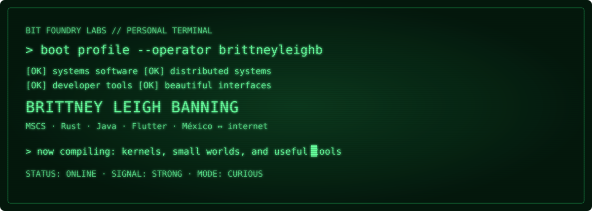

<div align="center">



**MS Computer Science student; building operating systems, distributed systems, developer tools, and small worlds with personality.**

[ BIT FOUNDRY LABS ](https://github.com/bit-foundry-labs)  ·  [ PROJECT INDEX ](#project-index)  ·  [ FIELD NOTES ](#field-notes)

</div>

```text
STATUS     : building in public
SIGNAL     : Rust · Java · Flutter · systems design
UPLINK     : México ↔ internet
NOW RUNNING: Embers Kernel / Emberglass OS / Mindful Moments
```

## /featured/embers-kernel

```
             ┌──────────────────────┐
             │   EMBERS KERNEL      │
             │  Rust · no_std       │
             └──────────┬───────────┘
                        │ capabilities · IPC · memory ownership
              ┌─────────▼─────────┐
              │  trusted kernel   │
              └─────────┬─────────┘
                        │
          ┌─────────────┴─────────────┐
          ▼                           ▼
   user-space services         deterministic tests
```

[**Embers Kernel**](https://github.com/bit-foundry-labs/embers-kernel) is a Rust-first microkernel research project. I’m exploring capability-based isolation, predictable resource control, and an operating-system foundation where AI services stay outside the trusted core.

It is early research, not a finished or benchmark-proven “AI kernel.” The interesting work is making the boundaries real.

[Contribute →](https://github.com/bit-foundry-labs/embers-kernel/blob/main/CONTRIBUTING.md) · [Research roadmap →](https://github.com/bit-foundry-labs/embers-kernel/blob/main/docs/CONTRIBUTOR_ROADMAP.md) · [Open issues →](https://github.com/bit-foundry-labs/embers-kernel/issues)

## /currently-building

| Process | What it is |
| :-- | :-- |
| **Emberglass OS** · private | A Linux-native, Rust-based desktop environment exploring activity-centered UX and local-first AI permissions. |
| **Mindful Moments** · private | A bilingual Flutter mindfulness and journaling app. |
| **Forge Loop** · private | A local-first agent-workbench concept built around approvals, limits, and evidence. |

## /project-index

```
SYSTEMS      [Raft KV Store] [Neural Trace]
APPS + GAMES [Café Nebula] [Ándale]
```

[Raft KV Store](https://github.com/brittneyleighb/raft-project) · [Neural Trace](https://github.com/brittneyleighb/neural-trace) · [Café Nebula](https://github.com/brittneyleighb/cafe-nebula)

## /field-notes

[Operating systems](https://github.com/brittneyleighb/notes-on-operating-systems) · [Database design](https://github.com/brittneyleighb/database-design-master-reference) · [Programming languages](https://github.com/brittneyleighb/programming-languages-comparison) · [Git cheatsheet](https://github.com/brittneyleighb/git-github-cheatsheet)

```
> No beige dashboards. No black-box magic.
> Just curious systems, clear boundaries, and software with a little soul.
```

[**Bit Foundry Labs**](https://github.com/bit-foundry-labs) · [**Email**](mailto:brittneyleighb@gmail.com)
