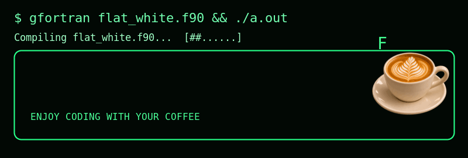

<div align="center">
  <a href="https://giphy.com/gifs/mrw-top-escalator-Nx0rz3jtxtEre">
    
  </a>
</div>

<div align="center">

[](https://github.com/bit-foundry-labs/embers-kernel)


**MS Computer Science student focused on operating systems, distributed systems, developer tools, and interaction design.**

`$` [cd bit-foundry-labs](https://github.com/bit-foundry-labs) · `$` [ls project-index](#project-index) · `$` [cat field-notes](#field-notes)

</div>

## /route

```text
$ ./route --interest
[1] kernels + systems       [2] developer tools
[3] apps + software design  [4] collaboration
```

<details>
<summary><code>[1] open kernels + systems</code></summary>

<br>

Start with [Embers Kernel](https://github.com/bit-foundry-labs/embers-kernel) for Rust, `no_std`, capabilities, memory ownership, and IPC. Then explore the [Raft KV Store](https://github.com/brittneyleighb/raft-project) and [operating-systems notes](https://github.com/brittneyleighb/notes-on-operating-systems).

</details>

<details>
<summary><code>[2] open developer tools</code></summary>

<br>

[Forge Loop](https://github.com/bit-foundry-labs/forge-loop) explores local agent work with explicit approvals, limits, and execution evidence. Emberglass OS carries related questions into the desktop environment.

</details>

<details>
<summary><code>[3] open apps + software design</code></summary>

<br>

Mindful Moments, Sakura Study App, and [Café Nebula](https://github.com/brittneyleighb/cafe-nebula) explore bilingual experiences, learning workflows, and expressive interfaces.

</details>

<details>
<summary><code>[4] open collaboration</code></summary>

<br>

For Embers Kernel, the most useful starting points are Rust/`no_std`, QEMU-based testing, documentation, and review of capability or IPC design. Start with the [contributor guide](https://github.com/bit-foundry-labs/embers-kernel/blob/main/CONTRIBUTING.md).

</details>

## /now

```text
$ cat /now
RESEARCH    Embers Kernel: capabilities, IPC, and memory ownership
BUILDING    Sakura Study App: daily study activities and iPad/iPhone release work
SHIPPING    Mindful Moments: bilingual activities and saved journal entries
MAINTAINING Forge Loop: local agent approvals, limits, and evidence reporting
STUDYING    Internet Architecture & Protocols
```

```text
$ git status --short
LAST SHIP       profile terminal interface · 2026-11-18
NEXT MILESTONE  Embers Kernel IPC v1
```

## /featured/embers-kernel

```
             ┌──────────────────────┐
             │   EMBERS KERNEL      │
             │  Rust · no_std       │
             └──────────┬───────────┘
                        │ capabilities · IPC · memory ownership
              ┌─────────▼─────────┐
              │  trusted kernel   │
              └─────────┬─────────┘
                        │
          ┌─────────────┴─────────────┐
          ▼                           ▼
   user-space services         deterministic tests
```


[**Embers Kernel**](https://github.com/bit-foundry-labs/embers-kernel) is a Rust-first microkernel research project exploring capability-based isolation, predictable resource control, and a small trusted computing base.

Early-stage research, not a finished or benchmark-proven kernel.

### /collaborate

Interested in helping? The most useful starting points are Rust/`no_std`, QEMU-based testing, documentation, and review of capability or IPC design. Begin with the [contributor guide](https://github.com/bit-foundry-labs/embers-kernel/blob/main/CONTRIBUTING.md), then choose a scoped task from the [roadmap](https://github.com/bit-foundry-labs/embers-kernel/blob/main/docs/CONTRIBUTOR_ROADMAP.md) or [open issues](https://github.com/bit-foundry-labs/embers-kernel/issues).

## /project-map

```text
SYSTEMS RESEARCH
├── Embers Kernel ── capability isolation · IPC · memory ownership
├── Emberglass OS ── desktop UX · local-first AI boundaries
└── Forge Loop ──── approved local agent execution

APPLICATION WORK
├── Mindful Moments ─ bilingual mindfulness + journaling
└── Sakura Study App ─ study workflows for iPad and iPhone
```

## /project-records

<details>
<summary><code>$ open embers-kernel --details</code></summary>

<br>

**Stack:** Rust, `no_std`, x86-64, QEMU  
**Current focus:** capability model, protected memory, IPC guarantees  
**Public repository:** [bit-foundry-labs/embers-kernel](https://github.com/bit-foundry-labs/embers-kernel)

</details>

<details>
<summary><code>$ open emberglass-os --details</code></summary>

<br>

**Stack:** Rust, Linux-native desktop technologies  
**Current focus:** activity-centered UX and local-first AI boundaries  
**Availability:** private research project

</details>

<details>
<summary><code>$ open forge-loop --details</code></summary>

<br>

**Current focus:** explicit approvals, execution limits, and evidence reporting for local agent work  
**Availability:** private developer-tool project

</details>

<details>
<summary><code>$ open mindful-moments --details</code></summary>

<br>

**Stack:** Flutter, Supabase  
**Current focus:** bilingual daily activities and saved journal entries  
**Availability:** private app project

</details>

<details>
<summary><code>$ open sakura-study-app --details</code></summary>

<br>

**Target:** iPad and iPhone release  
**Current focus:** a 365-day activity catalogue, product design, and store-submission preparation  
**Availability:** private app project

</details>

<details>
<summary><code>$ open raft-kv-store --details</code></summary>

<br>

**Stack:** Java  
**Scope:** distributed key-value-store coursework exploring Raft terms, vote requests, and leader-election behavior  
**Public repository:** [brittneyleighb/raft-project](https://github.com/brittneyleighb/raft-project)

</details>

## /project-index

**Systems:** [Raft KV Store](https://github.com/brittneyleighb/raft-project) · [Neural Trace](https://github.com/brittneyleighb/neural-trace)

**Apps + games:** [Café Nebula](https://github.com/brittneyleighb/cafe-nebula) · Ándale (private)

## /off-duty

```text
$ cat /off-duty
INTERESTS  travel · architecture · interior design
```

<details>
<summary><code>$ ls favorite-films</code></summary>

<br>

*Star Wars* · *The Matrix* · *Requiem for a Dream* · *Fight Club* · *A Walk to Remember* · *2001: A Space Odyssey* · *Interstellar*

</details>

<details>
<summary><code>$ ls favorite-books</code></summary>

<br>

- *The Count of Monte Cristo* — Alexandre Dumas
- *The Three Musketeers* — Alexandre Dumas
- *Les Misérables* — Victor Hugo
- *Pride and Prejudice* — Jane Austen
- *Walden* — Henry David Thoreau
- *Ready Player One* — Ernest Cline
- *Less Is More: How Degrowth Will Save the World* — Jason Hickel
- [*The Divide: A Brief Guide to Global Inequality and Its Solutions*](https://www.goodreads.com/book/show/32603498-the-divide "The Divide: A Brief Guide to Global Inequality and its Solutions") — Jason Hickel
- *Harry Potter* — J. K. Rowling
- *The Prophet* — Khalil Gibran
- *The Giving Tree* — Shel Silverstein
- [*Awakening the Luminous Mind: Tibetan Meditation for Inner Peace and Joy*](https://www.goodreads.com/book/show/13227894-awakening-the-luminous-mind "Awakening The Luminous Mind: Tibetan Meditation for Inner Peace and Joy") — Tenzin Wangyal Rinpoche

</details>

## /field-notes

[Operating systems](https://github.com/brittneyleighb/notes-on-operating-systems) · [Database design](https://github.com/brittneyleighb/database-design-master-reference) · [Programming languages](https://github.com/brittneyleighb/programming-languages-comparison) · [Git cheatsheet](https://github.com/brittneyleighb/git-github-cheatsheet)

<details>
<summary><code>$ cat operator-notes</code></summary>

<br>

I care about:

- Local-first software that remains useful without a permanent network dependency.
- Explicit permissions, resource boundaries, and systems whose behavior can be inspected.
- Reproducible builds and tests that make claims checkable.
- Interfaces that make powerful technical work feel understandable.

</details>

<details>
<summary><code>$ sudo make coffee</code></summary>

<br>

```fortran
! flat_white.f90 — pseudo-hardware recipe, Fortran 2008
program flat_white
  implicit none

  real, parameter :: espresso_ml = 36.0
  real, parameter :: milk_ml     = 120.0
  real, parameter :: milk_c      = 60.0

  call grind_fine()
  call pull_shot(espresso_ml)
  call steam_microfoam(milk_ml, milk_c)
  call pour("thin", "rosetta optional")

contains

  subroutine grind_fine()
    print *, "Grinding beans..."
  end subroutine grind_fine

  subroutine pull_shot(volume)
    real, intent(in) :: volume
    print *, "Pulling ", volume, " ml double espresso."
  end subroutine pull_shot

  subroutine steam_microfoam(volume, temperature)
    real, intent(in) :: volume, temperature
    print *, "Steaming ", volume, " ml milk to ", temperature, " C."
  end subroutine steam_microfoam

  subroutine pour(texture, finish)
    character(*), intent(in) :: texture, finish
    print *, "Pouring ", texture, " microfoam; ", finish
  end subroutine pour

end program flat_white
```

```text
$ gfortran -std=f2008 flat_white.f90 && ./a.out
Flat white ready.
```



*Enjoy coding with your coffee.*

</details>

[**Bit Foundry Labs**](https://github.com/bit-foundry-labs) · [**Email**](mailto:brittneyleighb@gmail.com)
