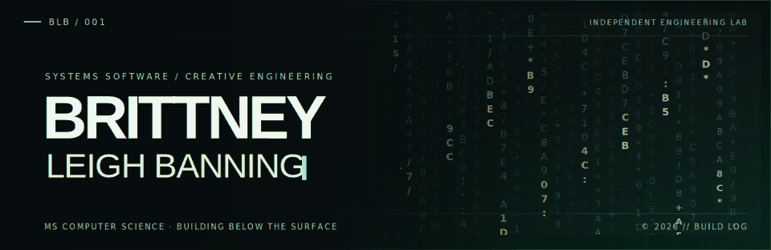
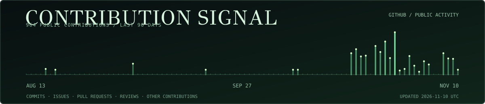
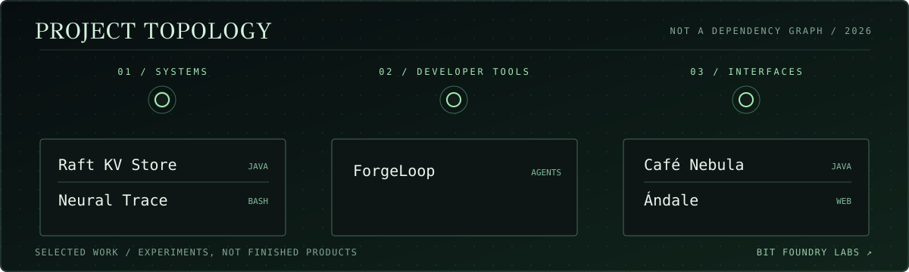

**Computer science MS student. Into operating systems, distributed systems, developer tools, and making software look good.**

[Bit Foundry Labs](https://github.com/bit-foundry-labs) · [Projects](#projects) · [Notes](#notes)

## Projects

**Systems:** [Raft KV Store](https://github.com/brittneyleighb/raft-project) · [Neural Trace](https://github.com/brittneyleighb/neural-trace)

**Developer tools:** [ForgeLoop](https://github.com/bit-foundry-labs/forge-loop)

**Interfaces + experiments:** [Café Nebula](https://github.com/brittneyleighb/cafe-nebula) · [Ándale](https://github.com/bit-foundry-labs/andale-spanish-app)

## Currently

Building apps, games, developer tools, and systems software. I care about innovation, creativity, beautiful design, and software that feels clean and efficient under the hood.

## Notes

[Operating systems](https://github.com/brittneyleighb/notes-on-operating-systems) · [Database design](https://github.com/brittneyleighb/database-design-master-reference) · [Programming languages](https://github.com/brittneyleighb/programming-languages-comparison) · [Git cheatsheet](https://github.com/brittneyleighb/git-github-cheatsheet)

[**Bit Foundry Labs**](https://github.com/bit-foundry-labs) · [**Email**](mailto:brittneyleighb@gmail.com)
